

<h2>🌍 Advancing AI for Carbon Cycle Science</h2>

The AI4Carbon Initiative is a community-driven effort to leverage cutting-edge machine learning for understanding and monitoring carbon cycles. We bridge top-down atmospheric inversion approaches with bottom-up ecosystem modeling through AI, advancing both atmospheric transport science and carbon accounting.

---

## Stay Connected

<h3>📧 Join Our Mailing List</h3>
<form action="https://mail.bgc-jena.mpg.de/mailman/subscribe/ai4carbon" method="POST">
  <input type="email" name="email" placeholder="your@email.com" required>
  <input type="submit" value="Subscribe">
</form>

<a href="https://mail.bgc-jena.mpg.de/mailman/listinfo/ai4carbon">View list details →</a>

---

## The Challenge

Artificial intelligence has revolutionized weather prediction and other scientific domains. Yet the carbon cycle—critical for understanding climate and supporting climate policy—remains largely untouched by these AI advances. AI4Carbon works to close this gap by leveraging machine learning across both atmospheric-based (top-down) and ecosystem-based (bottom-up) approaches to carbon science.

  

    <h3>🔬 The Top-Down Challenge</h3>
    
Atmospheric inverse modeling relies on coarse-resolution transport models, leading to systematic errors in retrieving surface carbon fluxes. Higher-resolution models exist in research but are computationally prohibitive for operational use.

  

  

    <h3>📊 The Data Gap</h3>
    
Unlike weather prediction, there is no consensus benchmark dataset for training machine learning models on atmospheric CO₂ transport. This lack of standardization hinders progress and collaboration across the research community.

  

  

    <h3>🤝 The Bottom-Up Complement</h3>
    
Ecosystem models and direct measurements provide valuable constraints, but integrating them with atmospheric observations remains challenging. AI can help unify these perspectives by learning patterns across scales and bridging gaps between different data sources.

  

💡 <strong>Our Vision:</strong> By bringing together atmospheric scientists, ecosystem modelers, machine learning researchers, and policy makers, we are exploring how AI methods could help unify top-down and bottom-up carbon cycle understanding, reducing uncertainties in our estimates of the global carbon cycle.

---

## Our Mission

  

    <h4>📈 Build Consensus</h4>
    
Establish benchmark datasets and evaluation frameworks for AI in carbon cycle research.

  

  

    <h4>🔗 Foster Community</h4>
    
Connect researchers across top-down atmospheric science, bottom-up ecosystem modeling, and machine learning through workshops and collaborative projects.

  

  

    <h4>🎯 Drive Impact</h4>
    
Develop and validate AI methods that improve carbon flux estimates and support climate monitoring.

  

  

    <h4>🌐 Enable Action</h4>
    
Provide tools and techniques that support policy-relevant carbon accounting and the Global Greenhouse Gas Watch.

  

---

## Upcoming Events

Join us at upcoming workshops and conferences to learn more about AI for carbon cycle science:

<a href="/workshops/" class="cta-button">📅 View All Workshops</a>
<a href="/resources/" class="cta-button cta-secondary">📚 Explore Resources</a>

---

## Community

AI4Carbon is an open community, not a fixed committee. Each workshop, session or meeting is organized by whoever wants to drive it, and you can find the organizers of every event on the <a href="/workshops/">workshops page</a>. Want to organize something under the AI4Carbon umbrella, or give a talk? Just get in touch!

A big thank you to everyone who has organized, presented, advised or otherwise helped shape AI4Carbon since 2024:

  

    
    <a href="https://www.ecmwf.int/en/about/who-we-are/staff-profiles/anna-agusti-panareda" target="_blank">Anna Agusti-Panareda</a>
    ECMWF & CAMS
  

  

    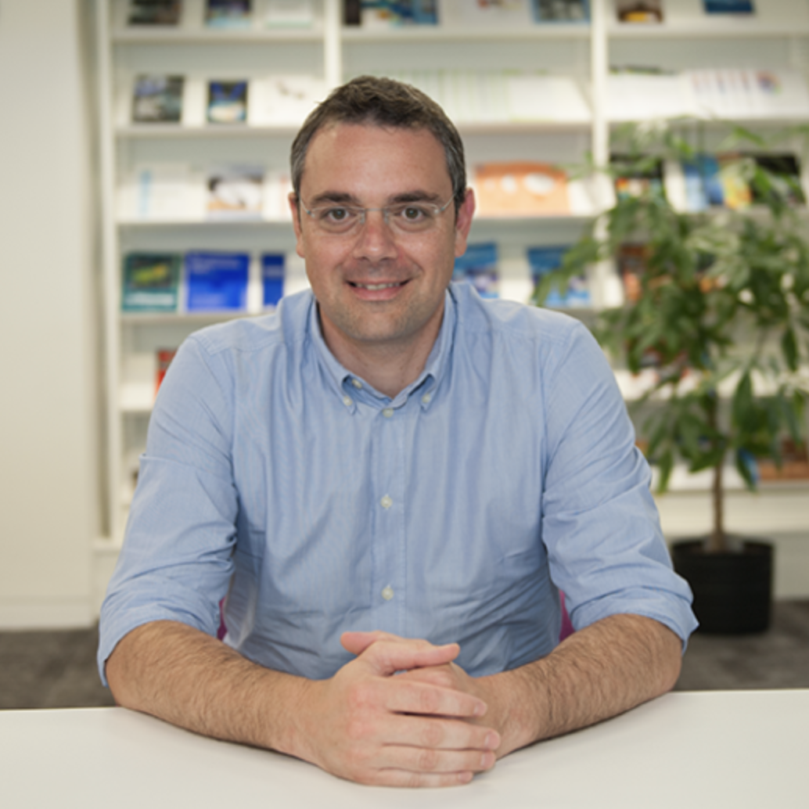
    <a href="https://wmo.int/profile/gianpaolo-balsamo" target="_blank">Gianpaolo Balsamo</a>
    WMO & G3W
  

  

    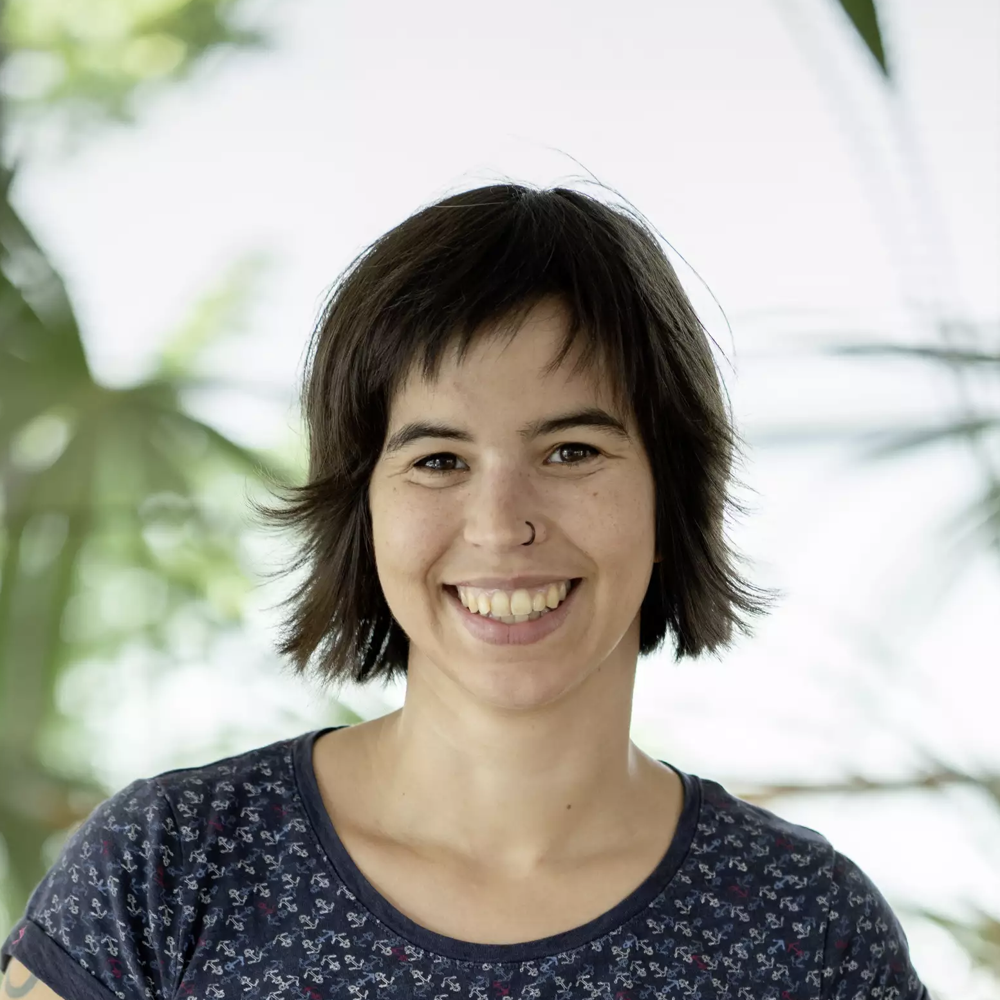
    <a href="https://www.bgc-jena.mpg.de/person/abastos/4680491" target="_blank">Ana Bastos</a>
    Leipzig University
  

  

    
    <a href="https://vitusbenson.github.io/" target="_blank">Vitus Benson</a>
    MPI for Biogeochemistry
  

  

    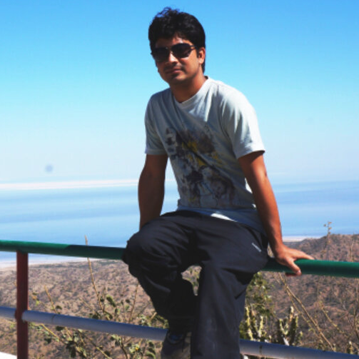
    <a href="https://www.researchgate.net/profile/Naveen-Chandra-2" target="_blank">Naveen Chandra</a>
    JAMSTEC
  

  

    
    <a href="https://www.lsce.ipsl.fr/Phocea/Pisp/index.php?nom=frederic.chevallier" target="_blank">Frédéric Chevallier</a>
    LSCE & CAMS
  

  

    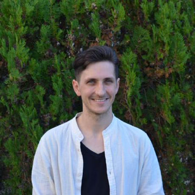
    <a href="https://github.com/KaiHCohrs" target="_blank">Kai-Hendrik Cohrs</a>
    University of Valencia
  

  

    
    <a href="https://nd349.github.io/" target="_blank">Nikhil Dadheech</a>
    University of Washington
  

  

    
    <a href="https://research-information.bris.ac.uk/en/persons/elena-fillola-mayoral" target="_blank">Elena Fillola</a>
    University of Bristol
  

  

    
    <a href="https://tailonghe.github.io/" target="_blank">Tai-Long He</a>
    University of Washington
  

  

    
    <a href="https://www.linkedin.com/in/yuming-jin-306a7b126" target="_blank">Yuming Jin</a>
    NCAR
  

  

    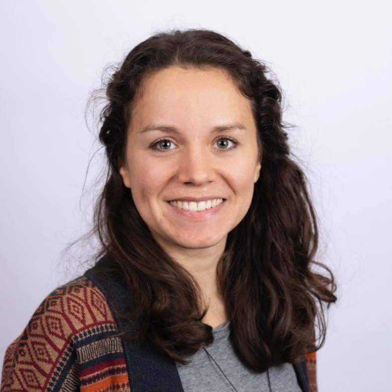
    <a href="https://www.linkedin.com/in/fiona-lippert-1179a3168/" target="_blank">Fiona Lippert</a>
    University of Amsterdam
  

  

    
    <a href="https://bse.carnegiescience.edu/dr-anna-michalak-0" target="_blank">Anna Michalak</a>
    Carnegie
  

  

    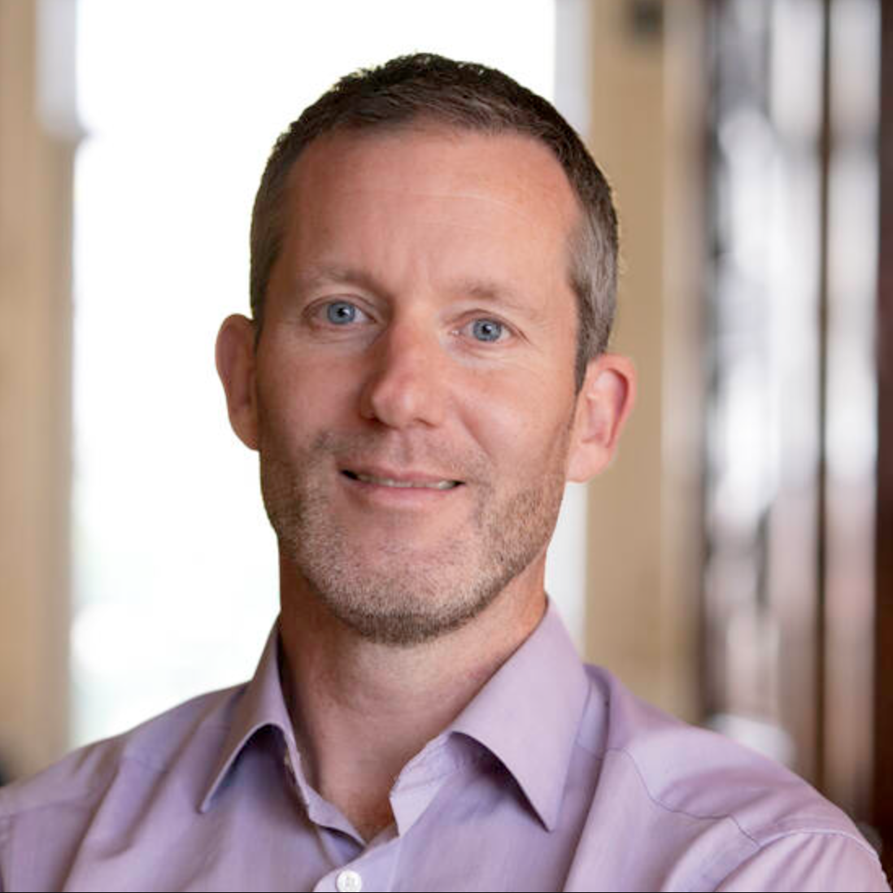
    <a href="https://www.wur.nl/en/persons/profdr-w-wouter-peters" target="_blank">Wouter Peters</a>
    Wageningen University
  

  

    
    <a href="https://www.bgc-jena.mpg.de/en/reichstein.html" target="_blank">Markus Reichstein</a>
    MPI for Biogeochemistry
  

  

    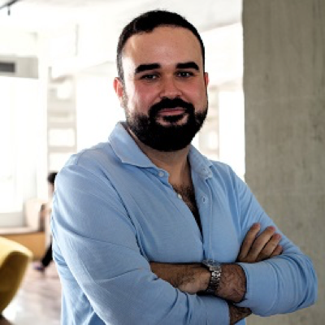
    <a href="https://carlosrodriguezpardo.es/" target="_blank">Carlos Rodriguez-Pardo</a>
    Politecnico di Milano & CMCC
  

  

    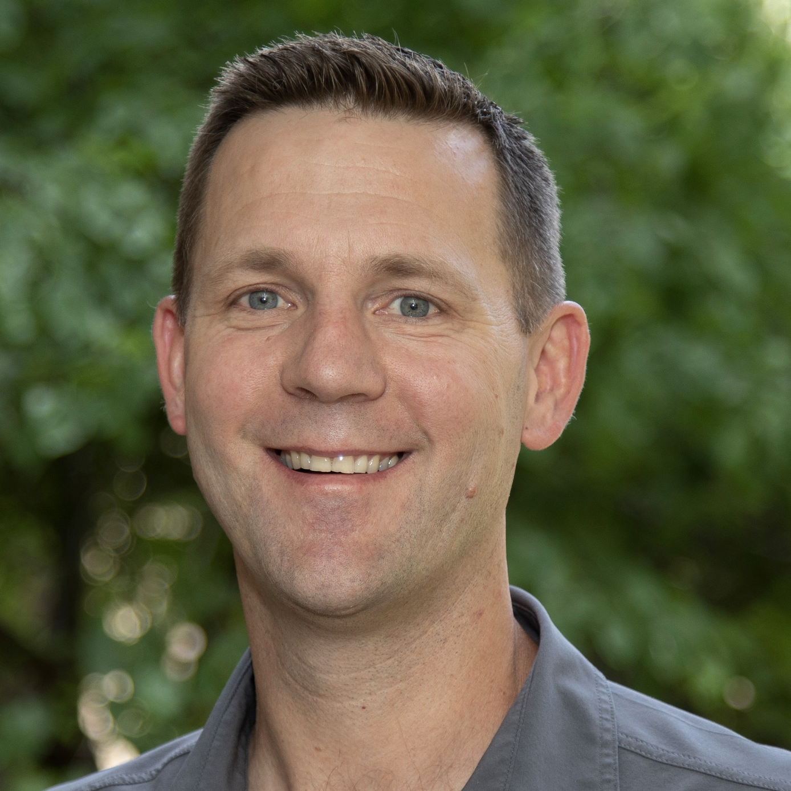
    <a href="https://cpaess.ucar.edu/cgc-host/dr-britton-stephens" target="_blank">Britt Stephens</a>
    NCAR
  

  

    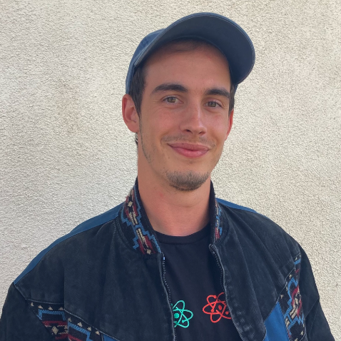
    <a href="https://www.linkedin.com/in/obin-sturm/" target="_blank">Obin Sturm</a>
    University of Southern California
  

  

    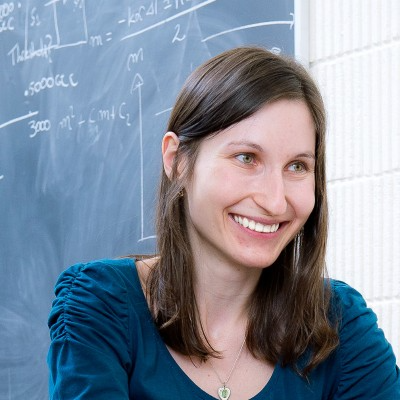
    <a href="https://kasiatokarska.com/" target="_blank">Kasia Tokarska de los Santos</a>
    
  

  

    
    <a href="https://alexjturner.github.io/index.html" target="_blank">Alex Turner</a>
    University of Washington
  

  

    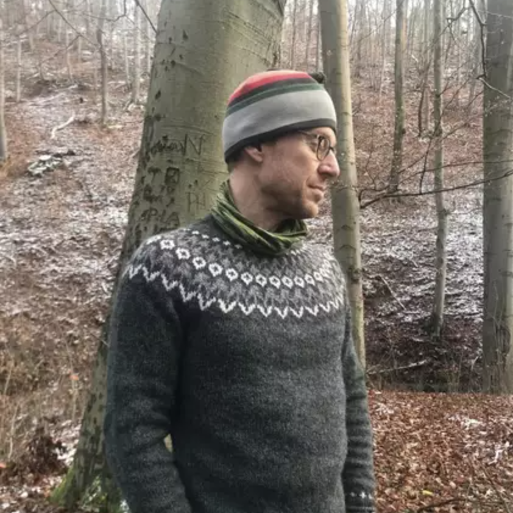
    <a href="https://www.bgc-jena.mpg.de/person/supton/4955530" target="_blank">Sam Upton</a>
    MPI for Biogeochemistry
  

  

    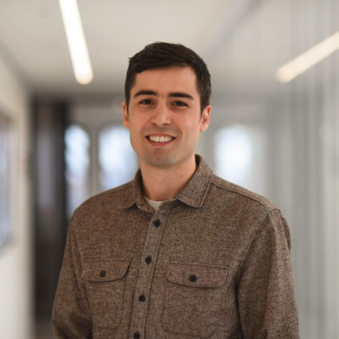
    <a href="https://www.varon.org/" target="_blank">Daniel Varon</a>
    Harvard University
  

…and every participant in our workshops and sessions. Missing from this list? Let us know!

## Contact

If you are interested in joining the collaborative effort, please reach out to vbenson (at) bgc-jena (dot) mpg (dot) de!
